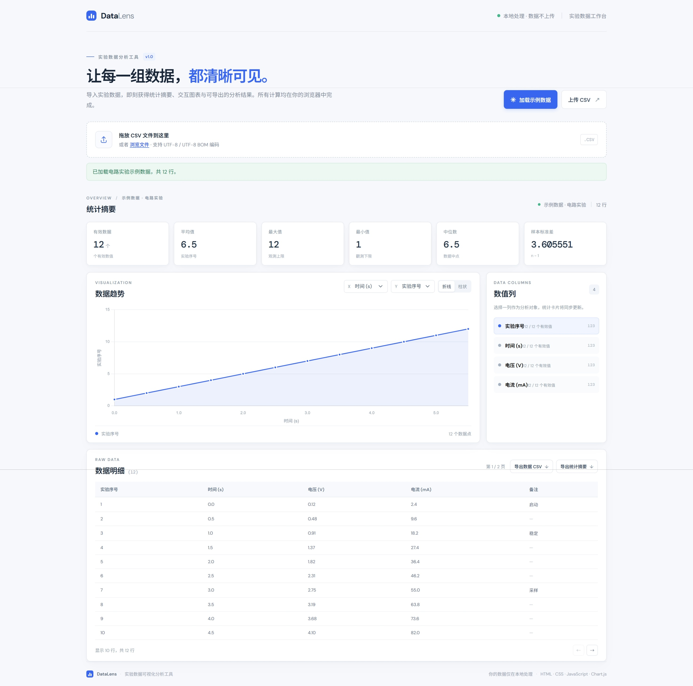

<div align="center">

# ◈ DataLens

### 实验数据可视化分析工具

为大学实验数据设计的轻量级 CSV 分析工作台。导入数据、查看统计、探索图表，并在浏览器本地完成导出。

[中文](#中文)　·　[English](#english)

<br>


</div>

---

## 中文

> 让实验数据更清晰，让分析过程更直接。

DataLens 是一款面向大学实验场景的轻量级 CSV 数据分析与可视化工具。项目使用原生 HTML、CSS 和 JavaScript 构建，在浏览器本地完成数据读取、统计计算、交互式图表、明细浏览和 CSV 导出。

无需账号、后端服务或数据库。你的 CSV 文件由浏览器在本地处理。

### 项目预览

<!-- 上传真实截图到 docs/screenshot.png 后，下面的图片会显示 -->
<div align="center">
  
  <br>
  <sub>DataLens 数据分析工作台 · 示例数据界面</sub>
</div>

### 能做什么

| 模块 | 功能 |
|:---|:---|
| 数据导入 | 选择或拖放 CSV 文件，支持 UTF-8 与 UTF-8 BOM |
| 示例体验 | 一键加载模拟电路实验数据 |
| 统计分析 | 计算有效值数量、平均值、最大值、最小值、中位数和样本标准差 |
| 数据可视化 | 折线图和柱状图切换；横轴、纵轴可分别选择 |
| 数据明细 | 表格分页查看，每页显示 10 行 |
| 文件导出 | 导出完整数据和统计摘要 CSV |
| 隐私保护 | 数据在浏览器本地处理，不由项目上传 |
| 异常提示 | CSV 格式错误或图表库不可用时显示提示 |

### 快速开始

需要安装 Node.js 18 或更新版本。

在项目目录打开终端，运行：

```bash
node server.js
然后在浏览器访问：
http://127.0.0.1:4173
停止服务时，在终端按 Ctrl+C。
测试
使用 Node.js 内置测试运行器：
node --test tests/core.test.js
如果已经安装 npm，也可以运行：
npm test
测试范围和未执行的浏览器检查记录在 [`tests.md`](tests.md)。
使用流程
01　打开 DataLens 页面
02　加载示例数据，或选择/拖放 CSV 文件
03　在数值列面板中选择要分析的列
04　调整图表横纵坐标，切换折线图或柱状图
05　分页查看数据明细
06　导出数据文件或统计摘要  
CSV 格式
首行为字段名，后续每行对应一条实验记录。字段使用逗号分隔。
实验序号,时间 (s),电压 (V),备注
1,0.0,0.12,启动
2,0.5,0.48,
3,1.0,0.91,稳定
含逗号或换行的字段应使用双引号包裹；字段内部的双引号写成两个双引号。文件需要至少包含一行表头、一行数据，并至少有一列含有效数值。
统计口径
指标	计算方式
有效数据数量	可解析为有限数字的非空单元格数量
平均值	有效数值之和 ÷ 有效数值数量
最大值 / 最小值	有效数值中的最大值与最小值
中位数	排序后居中的值；偶数个数据取中间两值的平均数
样本标准差	s = √(Σ(xᵢ − x̄)² / (n − 1))


空值和无法解析为有限数字的单元格不会计入统计。有效数值少于两个时，样本标准差显示为“—”；没有有效数值时，相关指标显示为“—”。
数据与隐私
CSV 文件使用浏览器 File API 在当前设备读取。项目没有接收 CSV 的后端服务，也不会主动把数据保存或上传到云端。
图表库 Chart.js 与字体通过第三方 CDN 加载静态资源。图表需要网络访问 Chart.js CDN；如果无法加载，统计、表格和导出功能仍可使用。CSV 文件内容不会由 DataLens 主动发送给 CDN。
当前限制
范围	当前情况
文件格式	支持逗号分隔 CSV；不支持 Excel 工作簿
字符编码	以 UTF-8 和 UTF-8 BOM 为目标
分隔符	不自动识别分号或制表符
数值格式	支持普通十进制与千分位逗号；不解析附带单位的数值
大型文件	数据在浏览器内存中处理，超大文件受设备内存和渲染速度影响
图表	依赖 CDN 加载 Chart.js；离线时统计、表格和导出仍可用


后续方向
→　图表 PNG 导出与可打印报告
→　线性拟合、残差与测量不确定度分析
→　更多 CSV 编码与分隔符选项
→　Web Worker 和大文件分块处理
→　可完全离线使用的本地图表库版本  
项目文件
文件	用途
index.html	页面结构
styles.css	页面样式与响应式布局
script.js	CSV 解析、统计、图表与导出
sample-data.csv	示例实验数据
server.js	本地静态服务器
tests/core.test.js	核心逻辑自动化测试
tests.md	测试执行记录
demo-guide.md	两分钟演示方案
portfolio.md	项目介绍与作品集材料


开源许可
本项目以 MIT License 发布，详见 LICENSE。
English
A lightweight workspace for clearer lab data and faster analysis.

DataLens is a browser-based CSV analysis and visualization tool for university lab work. Built with vanilla HTML, CSS, and JavaScript, it reads local files, computes descriptive statistics, renders interactive charts, displays paginated records, and exports CSV results.
No account, backend, or database is required. CSV data is processed locally in your browser.
Preview
<!-- Upload a real screenshot to docs/screenshot.png to display it here -->
<div align="center">
  
  <br>
  <sub>DataLens analysis workspace · Sample data view</sub>
</div>

Features
Area	Description
Import	Select or drop CSV files; UTF-8 and UTF-8 BOM are supported
Sample data	Load a simulated circuit experiment dataset
Statistics	Count, mean, maximum, minimum, median, and sample standard deviation
Charts	Switch between line and bar charts; choose X and Y columns independently
Data table	Browse records in pages of 10 rows
Export	Download raw data and statistical summaries as CSV
Privacy	Data is processed locally in the browser
Error states	Clear messages for invalid CSV files and unavailable chart resources


Quick start
Install Node.js 18 or later. From the project directory, run:
node server.js
Open http://127.0.0.1:4173 in your browser. Press Ctrl+C in the terminal to stop the server.
Tests
Run the core tests with Node.js:
node --test tests/core.test.js
If npm is available, you can also run:
npm test
See [`tests.md`](tests.md) for coverage and browser checks that have not yet been performed.
Statistics
Blank cells and values that cannot be parsed as finite numbers are excluded. Sample standard deviation uses the denominator n − 1 and is unavailable when fewer than two valid values are present.
Privacy
CSV files are read through the browser File API and processed on the current device. DataLens has no backend upload service and does not actively send CSV contents to a cloud service.
Chart.js and fonts are loaded as static resources from third-party CDNs. Charts require access to the Chart.js CDN. If it is unavailable, statistics, the data table, and exports remain available.
Limitations
The current version targets comma-separated UTF-8 CSV files. It does not import Excel workbooks or automatically detect alternate delimiters. Large files are limited by browser memory and rendering performance. Chart rendering depends on the Chart.js CDN.
License
Released under the MIT License. See LICENSE.
<div align="center">

<sub>Made for exploring experimental data · DataLens v1.0</sub>
</div>
```
